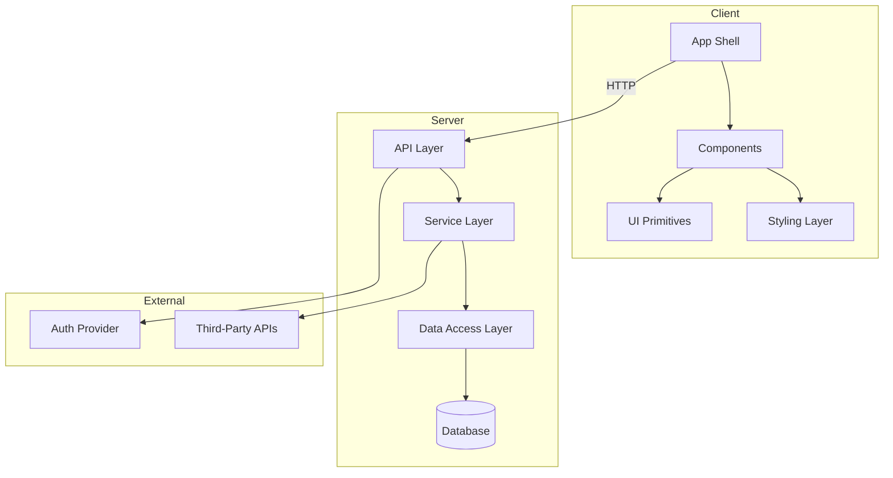
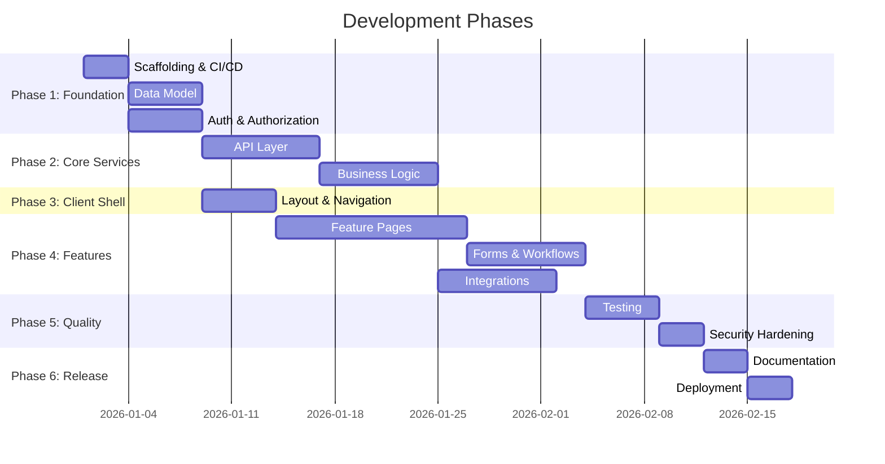
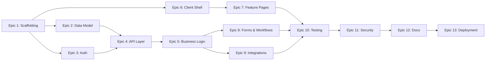
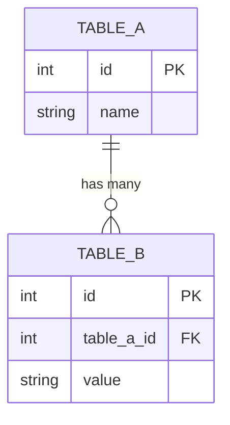

# Epic and issue body templates (epic-planner)

Read by the epic-planner procedure when it writes an issue body: Step 3 (master epic), Step 4
(child epic) and Step 5 (sub-issue). Fill every placeholder; delete a section that does not apply
rather than leaving it empty.

## Master epic body

````markdown
## Executive Summary

{1-2 paragraph description of the system being built}

## Tech Stack

| Layer | Technology | Rationale |
|-------|-----------|-----------|
| Client | {framework and UI toolkit} | {why} |
| Server | {runtime, framework, language} | {why} |
| Data | {database and access layer} | {why} |
| Auth | {provider and token strategy} | {why} |
| Testing | {unit and end-to-end runners} | {why} |
| CI/CD | {pipeline} | {why} |

> Fill this from the project's own manifest and `CLAUDE.md`, not from what is fashionable. If
> the repository already exists, every row here must match something you actually read.

## Architecture Overview



## Order of Operations



## Epic Dependency Graph



## Child Epics

| # | Epic | Phase | Story Points | Status |
|---|------|-------|-------------|--------|
| 1 | {Epic 1 title} #{issue_number} | Phase 1 | {points} | Not started |
| 2 | {Epic 2 title} #{issue_number} | Phase 1 | {points} | Not started |
| ... | ... | ... | ... | ... |

## Total Estimated Story Points: {sum}

## Research Sources

{Documents, URLs, and library docs consulted during planning — each with the version or
revision the claim applies to}

## Risks & Mitigations

| Risk | Impact | Likelihood | Mitigation |
|------|--------|-----------|------------|
| {risk} | High/Medium/Low | High/Medium/Low | {mitigation} |

## Open Questions

{Anything research could not confirm. Leave it visible here rather than guessing — an
assumption at this level is inherited by every sub-issue underneath it.}

## Living Documents

- {architecture doc named in CLAUDE.md} — maintained during implementation
- {user guide named in CLAUDE.md} — maintained during implementation
````

## Child epic body

````markdown
## Overview

{2-3 sentence description of what this epic accomplishes}

**Parent**: #{master_epic_number}
**Phase**: {phase number and name}
**Depends on**: #{dependency_epic_numbers}
**Blocked by**: {none or list}

## Scope

### In Scope
- {specific deliverable 1}
- {specific deliverable 2}

### Out of Scope
- {explicitly excluded item}

## Sub-Issues

| # | Issue | Story Points | Status |
|---|-------|-------------|--------|
| 1 | {title} #{number} | {points} | Not started |
| 2 | {title} #{number} | {points} | Not started |

## Architecture Notes

```mermaid
{relevant diagram — component, sequence, ER, or flow}
```

## Acceptance Criteria (Epic-level)

- [ ] All sub-issues completed and PRs merged
- [ ] The project's test gate passes, run exactly as `CLAUDE.md` documents it
- [ ] Coverage meets the project's stated threshold; where none is stated, every new code path
      is covered by a test that fails without the change
- [ ] Security scan clean using whatever scanner the project already runs
- [ ] Architecture doc updated with the relevant sections
- [ ] User guide updated if there are user-facing changes

## Total Story Points: {sum}
````

## Sub-issue body

````markdown
## Description

{Clear, actionable description of what needs to be done}

**Parent Epic**: #{epic_number}
**Story Points**: {1|2|3|5|8|13}

## Context

{Background, business rules, and technical context needed to implement this. Never assume the
implementer knows the domain — spell out every rule, formula, and workflow.}

## Acceptance Criteria

- [ ] {Specific, checkable condition 1 — names the failure it prevents}
- [ ] {Specific, checkable condition 2}
- [ ] {Specific, checkable condition 3}
- [ ] Unit tests written and passing, meeting the project's coverage gate
- [ ] Lint and typecheck clean, using the project's own commands
- [ ] Self-review checklist completed

## Technical Details

### Files to Create/Modify
- `path/to/file` — {what changes}

### API Contract (if applicable)
```
METHOD /api/endpoint
Request: { field: type }
Response: { field: type }
```

### Component Hierarchy (if UI)
```
ParentComponent
├── ChildComponent
│   ├── SubComponent
│   └── SubComponent
└── SiblingComponent
```

### Data Model (if applicable)


If this issue changes the data model, it needs a migration with a working, tested rollback.
Name the project's migration tool (from `CLAUDE.md`) here, and make "the rollback was executed
and the schema returned to its prior shape" one of the acceptance criteria — a rollback nobody
has run is not a rollback.

## Dependencies

- **Blocked by**: #{issue_numbers} (must be completed first)
- **Blocks**: #{issue_numbers} (depends on this)

## Definition of Done

- [ ] Code implemented and self-reviewed
- [ ] Tests pass and meet the project's coverage gate
- [ ] Lint and typecheck clean
- [ ] Migration applies and rolls back cleanly (if the data model changed)
- [ ] PR created with `Closes #{this_issue_number}`
- [ ] Architecture doc updated (if architectural changes)
- [ ] User guide updated (if user-facing changes)
````
