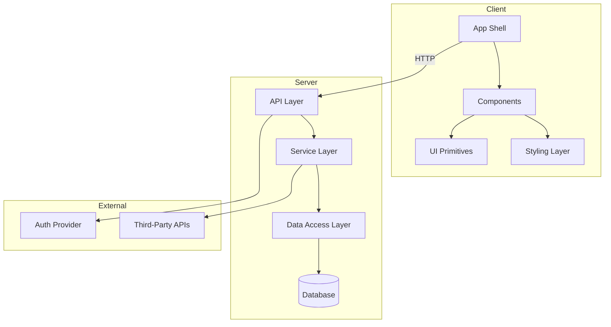
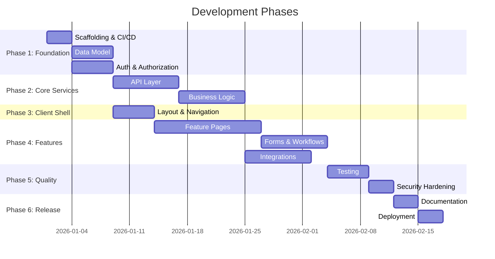
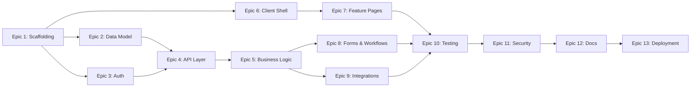
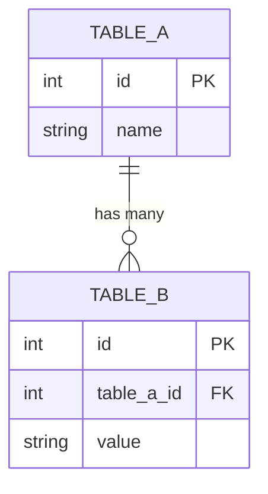

# Epic Planner

## Purpose

This skill drives the **`delivery:code-planner`** agent through creating comprehensive,
well-structured GitHub epics and sub-issues. It produces professional issue hierarchies with
Mermaid diagrams, acceptance criteria, story points, dependencies, and a phased order of
operations for complex systems.

Invoke it directly as `/delivery:epic-planner`. If you also want research gathered first, run
the `/delivery:plan-epic` workflow instead — it runs research, then planning, and hands this
skill the summary.

## When to Use

- The user describes a feature, system, or project they want to build
- The user asks to "plan", "create epics", "break down", or "scope" work
- The user wants to organize development work into trackable GitHub issues
- After `/delivery:repo-scaffold` has set up a new project
- After `/delivery:research-gather` has produced a research summary

## Before You Start: Read the Project's Own Rules

**Read the project's `CLAUDE.md` (or `AGENTS.md`) FIRST and obey it exactly.** That is where a
project states its own hard rules: architecture, build and test commands, protected paths,
data-handling rules, and its label and milestone conventions. If `.claude/delivery.md` exists,
read it too. Neither file existing is fine — infer from the repository and say in your report
what you inferred.

Things the project's own file, not this skill, is authoritative about:

- **Directory layout.** Do not assume a two-package split, or any particular names for the
  server and client trees. Read the repository.
- **Commands.** The exact lint, test, typecheck and build invocations, including any
  interpreter or environment indirection the project requires.
- **Coverage and quality gates.** If the project states a threshold, use that number in
  acceptance criteria. If it does not, do not invent one — write "new code is covered by tests
  that fail without the change" instead.
- **Migrations.** Anything touching the data model needs a migration with a working, tested
  rollback — name the project's migration tool from `CLAUDE.md` in the issue body rather than
  assuming one.
- **Labels and milestones.** If the project defines its own taxonomy, that wins over the table
  below.
- **Protected or sensitive paths.** Some repositories forbid reading or committing certain
  files. Respect that in every issue you write: never instruct an implementer to open a path
  the project protects.

## Tools

**GitHub work uses the `gh` CLI.** It is always available, it authenticates independently of
any MCP server, and it behaves the same in every repository. No step in this skill may depend
on an MCP server being configured.

| Need | Command |
|------|---------|
| Identify the repo | `git remote -v`, `gh repo view --json nameWithOwner` |
| Read the open backlog | `gh issue list --repo <owner>/<repo> --state open --limit 200` |
| Search for a near-duplicate | `gh issue list --repo <owner>/<repo> --search "<terms>" --state all` |
| Read one issue | `gh issue view <number> --repo <owner>/<repo>` |
| Create an issue | `gh issue create --repo <owner>/<repo> --title "..." --body-file <path> --label epic` |
| Update an issue | `gh issue edit <number> --repo <owner>/<repo> --body-file <path>` |
| Create a label | `gh label create <name> --color <hex> --description "..."` |
| Link a sub-issue | `gh api` — see Step 5 |

> **Write long bodies to a file and pass `--body-file`.** An epic body is hundreds of lines of
> Markdown containing backticks, pipes, and fenced Mermaid blocks. Inlining that with `--body`
> mangles it and can break the shell. Write it to a scratch file first, then pass the path.

**Optional accelerators.** If a documentation or web-search MCP server (Context7, Tavily, or
similar) happens to be configured, use it for library documentation and pattern discovery. If
it is not, `WebSearch` and `WebFetch` cover the same ground. Never block a step on one being
present, and never tell the user to install one.

## Labels

Create and use these labels on every issue. If the label doesn't exist in the repo, create it.
If the project's own `CLAUDE.md` defines a different taxonomy, follow that instead.

| Label | Color (hex) | Description |
|-------|-------------|-------------|
| `epic` | `7057ff` | Top-level planning epic |
| `feature` | `1d76db` | New feature or enhancement |
| `frontend` | `0075ca` | Client, UI, styling work |
| `backend` | `d93f0b` | Server-side / API work |
| `database` | `0e8a16` | Schema, migrations, data access |
| `infra` | `fbca04` | Build, CI/CD, deployment config |
| `docs` | `d4c5f9` | Documentation updates |
| `testing` | `bfd4f2` | Test coverage and QA |
| `security` | `b60205` | Security-related work |
| `blocked` | `e4e669` | Waiting on another issue |

```bash
gh label create epic --color 7057ff --description "Top-level planning epic" 2>/dev/null \
  || gh label edit epic --color 7057ff --description "Top-level planning epic"
```

## Story Points (Fibonacci Scale)

| Points | Meaning | Example |
|--------|---------|---------|
| 1 | Trivial | Config change, copy update |
| 2 | Small | Simple component, single endpoint |
| 3 | Medium | Feature with tests, moderate complexity |
| 5 | Large | Multi-file feature, integration work |
| 8 | Very Large | Complex feature, significant refactor |
| 13 | Epic-sized | Should probably be split further |

---

## Workflow

### Step 0: Gather Context

#### 0a. Identify Target Repository
Determine the `<owner>/<repo>` for issue creation:
1. Check the existing git remote: `git remote -v`. If the project keeps more than one remote,
   pass the intended one explicitly rather than relying on a default.
2. Ask the user if it is not obvious: *"Which GitHub repository should I create these issues in?"*
3. Verify access before writing anything: `gh repo view <owner>/<repo> --json nameWithOwner`.

#### 0b. Do Not Duplicate an Existing Issue
**Read the open backlog before filing anything.**

```bash
gh issue list --repo <owner>/<repo> --state open --limit 200 \
  --json number,title,labels --jq '.[] | "\(.number)  \(.title)"'
gh issue list --repo <owner>/<repo> --state all --search "<two or three distinctive terms>"
```

Some projects also keep a committed dump of the backlog (an `open-issues.md` under their docs
directory, or similar). If one exists, read it — but treat `gh` as the source of truth, because
a committed dump goes stale the moment someone files an issue.

If you find an existing issue covering the same ground, say so and offer to extend it rather
than filing a second one. Two issues describing the same work is how two branches end up
editing the same files and one of them loses.

#### 0c. Research Sources — Ask the User

Present this prompt:
> **I can gather additional context to make the epics more detailed. Would you like me to:**
>
> 1. **Read local documents** from a directory you specify (Word, PDF, spreadsheet and slide
>    files converted to Markdown)
> 2. **Research from the web** using URLs you provide, or search for patterns and prior art
> 3. **Look up library docs** for the frameworks you plan to use
> 4. **Read the codebase** so the plan is grounded in what already exists
> 5. **Skip research** — I have enough context from your description
>
> *You can choose multiple options.*

For anything more than a couple of URLs, run `/delivery:research-gather` (or dispatch the
`delivery:research` agent) and use its summary as the input to Step 1. Carry its **Open
Questions** and **Could Not Confirm** sections forward — an unresolved question belongs in the
epic body. A wrong claim in a research summary is copied into an epic and then into every
sub-issue below it before anyone checks it.

### Step 1: Understand the Scope

Analyze what the user has described:

1. **Is this a single issue, a single feature, or an entire system?**
   - One coherent change, one reviewer, one PR → **file a single issue and stop.**
   - Single feature → create one epic with sub-issues
   - Entire system → create a **Master Epic** with child epics (order of operations)

   **If the work would be better as one issue than an epic, say so and file one. An epic with a
   single sub-issue is overhead** — it costs two issues, a link, and a status table to track
   what one issue already tracked.

2. **Identify domains/bounded contexts**: Group related functionality
3. **Identify dependencies**: What must be built before what?
4. **Identify unknowns**: What needs more research or user clarification?

Ask clarifying questions if scope is ambiguous:
> - *"Is this a new feature in an existing app, or a new system from scratch?"*
> - *"Who are the users? What are the key user journeys?"*
> - *"Are there external systems or APIs you need to integrate with?"*
> - *"Do you have existing data or schemas to work with?"*

### Step 2: Plan the Epic Structure

Create a visual plan before writing any issues.

#### For a Single Feature Epic:
```
Epic: [Feature Name]
├── Sub-issue 1: [Setup / scaffolding]
├── Sub-issue 2: [Core implementation]
├── Sub-issue 3: [Secondary feature]
├── Sub-issue 4: [Tests]
├── Sub-issue 5: [Documentation]
└── Sub-issue 6: [Polish / edge cases]
```

#### For a Full System (Master Epic):
```
Master Epic: [System Name] — Order of Operations
├── Phase 1: Foundation
│   ├── Epic 1: Project Scaffolding & CI/CD
│   ├── Epic 2: Data Model & Migrations
│   └── Epic 3: Authentication & Authorization
├── Phase 2: Core Services
│   ├── Epic 4: API Layer
│   └── Epic 5: Business Logic & Services
├── Phase 3: Client Shell
│   └── Epic 6: Layout, Navigation & Design System
├── Phase 4: Features
│   ├── Epic 7: Feature Pages
│   ├── Epic 8: Forms & Workflows
│   └── Epic 9: Integrations
├── Phase 5: Quality
│   ├── Epic 10: Testing Strategy
│   └── Epic 11: Security Hardening
└── Phase 6: Release
    ├── Epic 12: Documentation
    └── Epic 13: Deployment & Migration
```

Present the plan to the user for approval before creating issues.

### Step 3: Create the Master Epic (if full system)

Write the body to a file, then:

```bash
gh issue create --repo <owner>/<repo> \
  --title "[MASTER EPIC] {System Name} — Order of Operations" \
  --body-file ./epic-master.md --label epic
```

**Body template**:

````markdown
## Executive Summary

{1-2 paragraph description of the system being built}

## Tech Stack

| Layer | Technology | Rationale |
|-------|-----------|-----------|
| Client | {framework and UI toolkit} | {why} |
| Server | {runtime, framework, language} | {why} |
| Data | {database and access layer} | {why} |
| Auth | {provider and token strategy} | {why} |
| Testing | {unit and end-to-end runners} | {why} |
| CI/CD | {pipeline} | {why} |

> Fill this from the project's own manifest and `CLAUDE.md`, not from what is fashionable. If
> the repository already exists, every row here must match something you actually read.

## Architecture Overview



## Order of Operations



## Epic Dependency Graph



## Child Epics

| # | Epic | Phase | Story Points | Status |
|---|------|-------|-------------|--------|
| 1 | {Epic 1 title} #{issue_number} | Phase 1 | {points} | Not started |
| 2 | {Epic 2 title} #{issue_number} | Phase 1 | {points} | Not started |
| ... | ... | ... | ... | ... |

## Total Estimated Story Points: {sum}

## Research Sources

{Documents, URLs, and library docs consulted during planning — each with the version or
revision the claim applies to}

## Risks & Mitigations

| Risk | Impact | Likelihood | Mitigation |
|------|--------|-----------|------------|
| {risk} | High/Medium/Low | High/Medium/Low | {mitigation} |

## Open Questions

{Anything research could not confirm. Leave it visible here rather than guessing — an
assumption at this level is inherited by every sub-issue underneath it.}

## Living Documents

- {architecture doc named in CLAUDE.md} — maintained during implementation
- {user guide named in CLAUDE.md} — maintained during implementation
````

**Labels**: `epic`

### Step 4: Create Child Epics

For each child epic, create the issue, then link it to the master epic. The link command is the
same for epic-under-master as for issue-under-epic; it is shown once in Step 5.

**Child Epic body template**:

````markdown
## Overview

{2-3 sentence description of what this epic accomplishes}

**Parent**: #{master_epic_number}
**Phase**: {phase number and name}
**Depends on**: #{dependency_epic_numbers}
**Blocked by**: {none or list}

## Scope

### In Scope
- {specific deliverable 1}
- {specific deliverable 2}

### Out of Scope
- {explicitly excluded item}

## Sub-Issues

| # | Issue | Story Points | Status |
|---|-------|-------------|--------|
| 1 | {title} #{number} | {points} | Not started |
| 2 | {title} #{number} | {points} | Not started |

## Architecture Notes

```mermaid
{relevant diagram — component, sequence, ER, or flow}
```

## Acceptance Criteria (Epic-level)

- [ ] All sub-issues completed and PRs merged
- [ ] The project's test gate passes, run exactly as `CLAUDE.md` documents it
- [ ] Coverage meets the project's stated threshold; where none is stated, every new code path
      is covered by a test that fails without the change
- [ ] Security scan clean using whatever scanner the project already runs
- [ ] Architecture doc updated with the relevant sections
- [ ] User guide updated if there are user-facing changes

## Total Story Points: {sum}
````

### Step 5: Create Sub-Issues

Create each sub-issue, then link it to its parent epic:

```bash
NUM=$(gh issue create --repo <owner>/<repo> --title "..." \
        --body-file ./issue-3.md --label feature --label backend | grep -oE '[0-9]+$')

CHILD_ID=$(gh api repos/<owner>/<repo>/issues/"$NUM" --jq '.id')
gh api -X POST repos/<owner>/<repo>/issues/{parent_number}/sub_issues \
  -F sub_issue_id="$CHILD_ID"
```

Note the two different identifiers. The sub-issues endpoint takes the issue's **`id`** — the
global database id returned by `gh api` — not the `number` you see in the URL. Passing the
number either fails or links something else entirely.

**If sub-issue linking is unavailable**, fall back to a task list in the parent body: one
`- [ ] #{number}` per line renders as tracked work and keeps the hierarchy legible.

**Sub-Issue body template**:

````markdown
## Description

{Clear, actionable description of what needs to be done}

**Parent Epic**: #{epic_number}
**Story Points**: {1|2|3|5|8|13}

## Context

{Background, business rules, and technical context needed to implement this. Never assume the
implementer knows the domain — spell out every rule, formula, and workflow.}

## Acceptance Criteria

- [ ] {Specific, checkable condition 1 — names the failure it prevents}
- [ ] {Specific, checkable condition 2}
- [ ] {Specific, checkable condition 3}
- [ ] Unit tests written and passing, meeting the project's coverage gate
- [ ] Lint and typecheck clean, using the project's own commands
- [ ] Self-review checklist completed

## Technical Details

### Files to Create/Modify
- `path/to/file` — {what changes}

### API Contract (if applicable)
```
METHOD /api/endpoint
Request: { field: type }
Response: { field: type }
```

### Component Hierarchy (if UI)
```
ParentComponent
├── ChildComponent
│   ├── SubComponent
│   └── SubComponent
└── SiblingComponent
```

### Data Model (if applicable)


If this issue changes the data model, it needs a migration with a working, tested rollback.
Name the project's migration tool (from `CLAUDE.md`) here, and make "the rollback was executed
and the schema returned to its prior shape" one of the acceptance criteria — a rollback nobody
has run is not a rollback.

## Dependencies

- **Blocked by**: #{issue_numbers} (must be completed first)
- **Blocks**: #{issue_numbers} (depends on this)

## Definition of Done

- [ ] Code implemented and self-reviewed
- [ ] Tests pass and meet the project's coverage gate
- [ ] Lint and typecheck clean
- [ ] Migration applies and rolls back cleanly (if the data model changed)
- [ ] PR created with `Closes #{this_issue_number}`
- [ ] Architecture doc updated (if architectural changes)
- [ ] User guide updated (if user-facing changes)
````

### Step 6: Update Master Epic

After all child epics and sub-issues are created:

1. Regenerate the master epic body with the real issue numbers filled in
2. Fill in the Child Epics table
3. Update the Mermaid diagrams with actual issue references
4. Calculate and fill in total story points

```bash
gh issue edit {master_epic_number} --repo <owner>/<repo> --body-file ./epic-master.md
```

### Step 7: Handoff

Present to the user:

```markdown
## Epic Planning Complete

### Master Epic
- #{master_epic_number}: {title}

### Child Epics ({count})
| Epic | Issues | Story Points |
|------|--------|-------------|
| #{number}: {title} | {sub_count} | {points} |
| ... | ... | ... |

### Total
- **Epics**: {count}
- **Sub-issues**: {total_count}
- **Story points**: {total_points}
- **Estimated phases**: {phase_count}

### Assumptions I Made
- {anything inferred because CLAUDE.md / AGENTS.md did not state it}

### Recommended Starting Point
> Begin with **Epic #{first_epic}** (Phase 1: {name}).
> Run `/delivery:code-issue #{first_issue}` to start implementation, or hand the epic to the
> `delivery:orchestrator` agent to sequence implementation and review across its sub-issues.

### Living Documents
- {architecture doc} and {user guide} — maintained by the `delivery:code-issue` agent as the
  work lands
```

---

## Writing Acceptance Criteria That Can Be Checked

This is the part of an issue that decides whether the work lands correctly, and it is the part
most often written as decoration.

**Acceptance criteria must be checkable, not aspirational.** A criterion that restates the
feature tells the implementer nothing they did not already know, and it can never fail. A
criterion that names the failure being prevented can be executed, and it fails loudly when the
implementation is wrong.

| Aspirational (useless) | Checkable (useful) |
|---|---|
| "Retention works" | "A test proves a 90-day sweep leaves three-year evidence untouched" |
| "The import handles bad rows" | "A CSV with one malformed row imports the other 49 and reports the bad row by line number" |
| "Preferences are saved" | "After saving a preference and restarting the process, a fresh read returns the new value" |
| "The endpoint is secure" | "A request for another account's record returns 404, and a test asserts it" |
| "Performance is acceptable" | "Listing 100 rows issues one query, asserted by a query counter" |

The test to apply to every criterion you write: **could a reviewer run this and get a yes or a
no?** If it needs judgement, rewrite it until it does not.

### The defect shape worth naming explicitly

The single most common way a feature ships broken is this: **a write reports success while the
read cannot see it.** The user saves, the API returns 200, the log says stored — and the value
is not there on the next page load. It has four distinct causes, and a criterion that says
"saving works" catches none of them:

1. **Wrong storage** — the write landed somewhere the read path does not query: a cache instead
   of the store, a different table, a different key prefix, a different tenant or project scope.
2. **Wrong layer** — the request was accepted and validated at the edge, but nothing below it
   persisted anything. Every layer returned success because none of them was the layer that
   failed.
3. **Wrong time** — the write happened after the read, or inside a transaction that never
   committed, or behind a cache the write did not invalidate.
4. **Wrong harness** — the test asserted against the same in-memory object or the same open
   session that performed the write, so it would pass even if nothing had been persisted at all.

So when an issue involves persistence, write the criterion as a **round trip that crosses the
boundary**: *"a test writes the value through the public API, discards the session and cache,
reads it back through the same path the UI reads, and asserts equality."* One sentence, all
four causes closed.

The same shape applies to client state: state that a control writes and nothing renders from is
a no-op that still passes its tests. Make the criterion name the visible consequence —
*"toggling the filter changes which rows the table renders"* — not the store update.

### Scoping criteria

If the codebase partitions data (per project, per tenant, per account), every query criterion
must say which partition it filters on. A lookup that matches on the entity id alone will
happily return another partition's row, and the test will still pass because the fixture only
contains one. Require a fixture with two, from different partitions, and assert the second one
is not returned.

## Issue Writing Best Practices

These rules apply to ALL issues created by this skill:

1. **Titles are actionable** — start with a verb: "Implement", "Create", "Add", "Configure", "Design"
2. **Acceptance criteria are checkable** — each one verifies as pass/fail and names the failure it prevents
3. **Business logic is explicit** — never assume the developer knows the domain; spell out every rule, formula, and workflow
4. **Diagrams enhance clarity** — use Mermaid for architecture, data flow, sequences, and ER relationships
5. **Dependencies are bidirectional** — every "blocked by" has a corresponding "blocks"
6. **Story points reflect complexity** — not time. A 5-point issue is 5x more complex than a 1-point issue
7. **No issue should exceed 13 points** — if it does, split it
8. **Include file paths** — tell the developer exactly which files to create or modify, using paths that exist in this repository
9. **Include code contracts** — API request/response shapes, component props, function signatures
10. **Reference research sources** — link the docs, files, or URLs consulted, and record the version each claim applies to
11. **Respect the project's protected paths** — never write an instruction that sends an implementer into a path the project forbids reading or committing
12. **One issue, one reviewable change** — if a sub-issue cannot be reviewed on its own, it is two sub-issues

## Error Recovery

| Scenario | Action |
|----------|--------|
| GitHub API rate limited | Pause 60s, retry with exponential backoff |
| `gh` not authenticated | Report it and stop; do not fall back to an MCP server that may not exist |
| Issue creation fails | Log the error, continue with the remaining issues, retry the failures at the end |
| Sub-issue linking unsupported | Fall back to a `- [ ] #{number}` task list in the parent body |
| Label creation forbidden | Continue without the label and note it in the handoff |
| A near-duplicate issue exists | Stop, show the user the existing issue, offer to extend it |
| User rejects epic structure | Re-interview, adjust scope, regenerate |

## Tips

- Create all epics first, then sub-issues, then update the master epic — this ensures all issue numbers are available for cross-referencing
- Check the open backlog with `gh issue list` before creating anything, every time
- For very large systems (>100 issues), batch creation and add delays to avoid rate limiting
- The Gantt chart dates in the Master Epic are illustrative — prefer relative timing ("after X") over absolute dates
- Always create the docs epic last — it depends on knowing what was built
- Write every long body to a scratch file and pass `--body-file`; never inline a Mermaid block with `--body`
- Say what you inferred. A plan built on an assumption the user could have corrected in one sentence is the cheapest failure in this workflow to avoid
